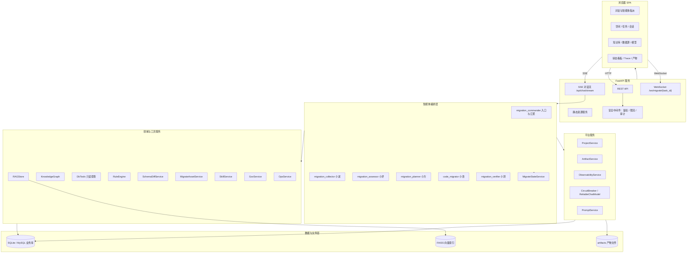
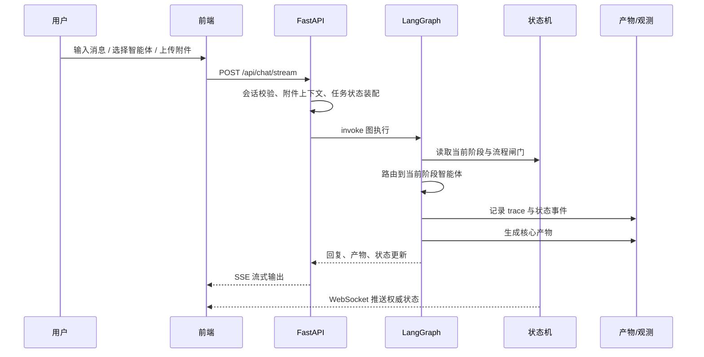
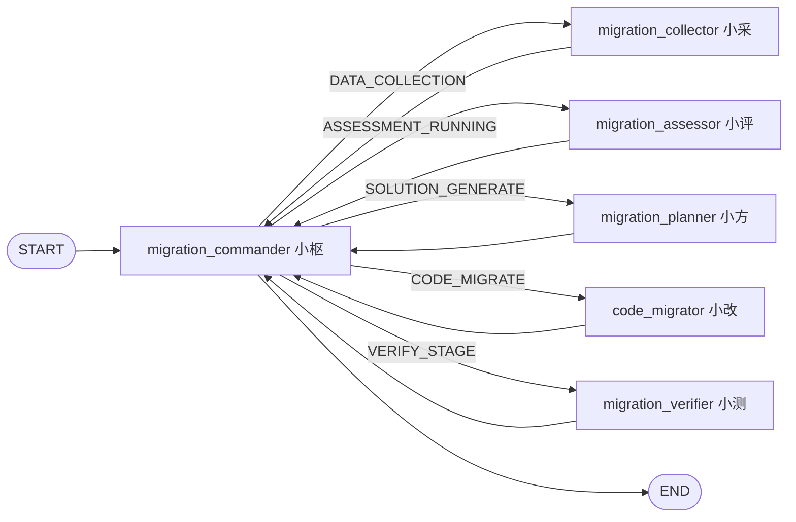
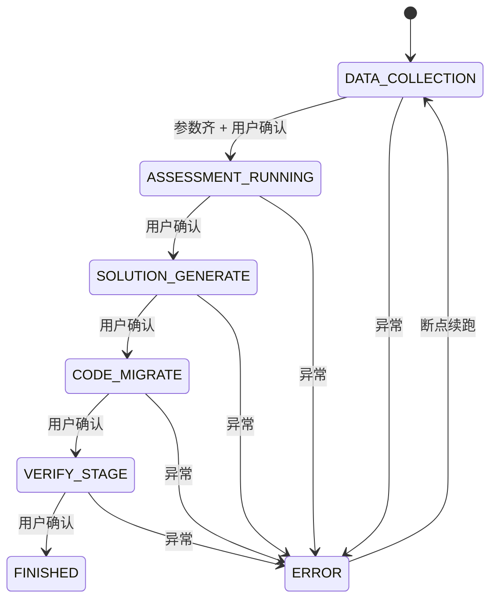
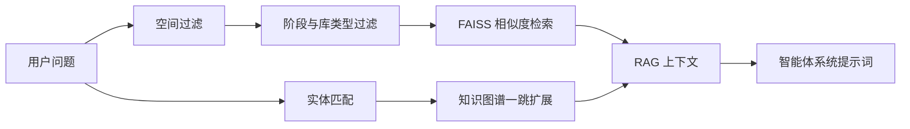

# 数据库国产化迁移智能编排平台架构文档

> 版本：2026-10-10
>
> 依据：当前工作区代码实现。若本文与代码不一致，以代码为准。
> 密钥说明：本文只描述配置结构与安全边界，不包含任何真实 API Key 或数据库凭证。

## 1. 系统定位

数据库国产化迁移智能编排平台（DB Loc Agent）面向 Oracle、MySQL、SQL Server 等传统数据库到达梦 DM、人大金仓 Kingbase、GaussDB、OceanBase 等国产数据库的迁移场景。平台将 LLM 对话能力、多智能体编排、确定性迁移工具、状态机流程控制、知识库与产物管理组合成一条可审计的迁移链路。

系统的核心设计原则：

1. **状态机是权威流程控制器**：迁移阶段由后端状态表与确定性规则驱动，LLM 无权直接跳转阶段。
2. **LLM 负责语义与表达，确定性工具负责事实**：兼容性风险、结构差异、只读查询等由规则引擎、Schema Diff、数据库工具完成，可复现、可溯源。
3. **配置数据驱动智能体**：智能体、流水线、提示词、字典从数据库读取，不写死在代码中；`data/seed/*.json` 负责新环境初始化。
4. **任务、会话、产物全链路归属**：空间、任务、会话、状态事件、trace、产物版本互相关联，支持断点续跑与审计回看。
5. **旁路能力不能阻塞主流程**：状态事件、trace 日志、审计日志写入失败不影响主状态机权威状态。

## 2. 总体架构



### 2.1 技术栈

| 层级 | 技术 |
| --- | --- |
| 前端 | Vite 8、React 19、TypeScript、Tailwind CSS、Radix UI、lucide-react、react-markdown |
| 后端 | Python 3.13、FastAPI、SQLAlchemy 2.x、LangChain、LangGraph |
| LLM | Ollama、DeepSeek、阿里云百炼、智谱，均通过统一 LLM 工厂适配 |
| 检索 | FAISS 向量检索、知识图谱一跳扩展、分层知识库过滤 |
| 业务库 | SQLite 或 MySQL，通过 `mysql_url` 切换 |
| 实时通信 | SSE 对话流、WebSocket 迁移状态流 |
| 文件 | 本地 `artifacts/` 产物目录、技能目录、知识库文件 |

## 3. 前端架构

### 3.1 应用结构

```text
web-ui/src/
├── App.tsx                         # 应用状态、hash 路由、页面切换
├── components/
│   ├── chat/                       # 欢迎页、聊天、输入框、智能体选择、产物面板
│   ├── layout/                     # 侧边栏、顶部栏
│   ├── migrate/                    # 迁移流程、状态看板
│   ├── project/                    # 任务列表、任务详情、新建/删除/绑定任务
│   ├── space/                      # 空间详情与遗留子系统页面
│   ├── workbench/                  # 知识库、智能体、数据源、模型、治理、运维等面板
│   └── ui/                         # 基础 UI 组件
├── hooks/                          # 会话、健康检查、SSE 流、状态 WebSocket
└── lib/                            # API 封装、类型、状态与展示工具
```

### 3.2 主要页面与路由

| 入口 | 说明 |
| --- | --- |
| `#/workspace/{tab}` | 工作台面板，支持知识库、智能体、数据源、模型、治理、运维等直达 |
| `#/chat/{id}` | 打开指定会话 |
| 任务页 | 空间筛选、任务列表、任务详情、状态机链路、Trace、重试 |
| 欢迎页 / 聊天页 | 用户指派智能体、发送消息、上传附件、查看产物与阶段状态 |

### 3.3 会话与任务视图

当前业务主线已经简化为：

```text
空间 Space
  └── 业务任务 ProjectTask
        └── 会话 Conversation
              ├── 消息 Message
              ├── ChatTrace
              └── 产物 ArtifactRecord
```

说明：

- 新建会话默认归属 `默认空间`；后端创建接口在未显式传空间时也会自动创建或复用默认空间。
- 快速问答是独立轻量模式，不承载完整项目任务与产物链路。
- 数据库中仍保留 `space_subsystems` 表以兼容历史数据，但主 UI 和主流程已不再把子系统作为必经层级。

### 3.4 前端数据流

1. `lib/api.ts` 统一封装 REST API。
2. `use-chat-stream.ts` 处理 SSE 事件、流式文本、阶段状态、子智能体调用与错误。
3. `use-migrate-state-socket.ts` 连接 WebSocket，接收权威状态快照与状态事件。
4. 任务页与聊天页共享状态机快照，避免仅凭对话文本推断阶段。
5. 产物面板只展示核心产物，过程日志和中间系统事件从产物列表中过滤。

## 4. 后端架构

### 4.1 应用初始化

`jarvis_agent/app.py::create_app()` 是后端组合根，负责：

1. 读取 `config.yaml` 并应用测试或调用方覆盖配置。
2. 创建 `Database`，默认 SQLite；配置 `mysql_url` 后切换 MySQL。
3. 初始化服务对象：
   - `PromptService`
   - `SkillService`
   - `ArtifactService`
   - `ProjectService`
   - `AgentService`
   - `ObservabilityService`
   - `DbTools` 与 DB 熔断器
   - `SchemaDiffService`
   - `KnowledgeGraph`
   - `GovService`
   - `OpsService`
   - `RAGStore`
   - `RuleEngine`
   - `MigrateStateService`
   - `MigrateAssetService`
   - `MigrateStateBroadcaster`
4. 构建会话取消注册表、SSE 流、REST 路由、WebSocket 路由和静态资源服务。
5. 挂载安全中间件。

### 4.2 REST 与实时接口

| 类别 | 代表接口 | 职责 |
| --- | --- | --- |
| 会话 | `/api/conversations` | 会话 CRUD、任务绑定、空间绑定、消息与 trace 查询 |
| 空间 | `/api/spaces`、`/api/spaces/default` | 空间管理、默认空间保障 |
| 任务 | `/api/tasks` | 业务任务列表、创建、详情、更新、删除 |
| 对话 | `/api/chat/stream` | SSE 流式对话、附件上下文、智能体指派、取消 |
| 取消 | `/api/chat/{cid}/cancel` | 服务端取消当前智能体执行 |
| 迁移 | `/api/migrate/*` | 迁移任务、阶段推进、重试、流程编排、规则、资产、报告导出 |
| 知识库 | `/api/kb/*` | 空间知识库、文档、分块、检索 |
| 产物 | `/api/artifacts/*`、`/api/products/*` | 产物预览、下载、版本、Diff、入库 |
| 追踪 | `/api/trace/{trace_id}` | 全局链路日志 |
| 状态 | `/ws/migrate/{task_id}` | 初始快照、状态快照、状态事件、ping/pong |

### 4.3 SSE 对话流程



## 5. 智能体编排架构

### 5.1 配置化注册中心

`agents.py` 不内置智能体清单，而是从 `agents` 表读取 `AgentDef`。新环境通过 `run_seed.py` 导入 `data/seed/*.json`。

每个智能体配置包含：

| 字段组 | 内容 |
| --- | --- |
| 身份 | `agent_id`、名称、别名、描述、类型 |
| 路由 | `intent`、启用状态 |
| 编排 | `agent_type`、`sub_agents`、阶段、产品类型 |
| 提示词 | 默认提示词、提示词 ID、系统角色提示词 ID |
| 工具与产物 | 工具列表、是否生成产物、输出文件清单 |

只有启用的智能体参与意图解析、前端指派和子智能体调用。

### 5.2 当前 LangGraph 图

当前图以 `migration_commander` 作为入口与汇聚节点，五个迁移阶段节点由条件边路由：



`migration_commander` 承担两类职责：

1. **入口**：解析用户意图、处理显式智能体指派、校验阶段闸门、选择目标节点。
2. **汇聚**：阶段节点完成后回到指挥官，由其落产物、生成回复，并等待后端状态机推进。

非迁移阶段智能体（如知识问答、运维巡检、数据治理等）不一定需要独立图节点；在入口节点内复用通用执行核心，完成提示词装配、工具循环和产物生成。

### 5.3 严格流程与自由流程

任务表 `db_migrate_task.strict_flow` 控制流程策略：

| 模式 | 行为 |
| --- | --- |
| `strict_flow=true` | 严格按状态机当前阶段允许对应智能体执行，越级指派会被阶段闸门拦截 |
| `strict_flow=false` | 用户指定哪个阶段智能体，就优先执行该智能体，不因前序阶段未完成而拒绝 |

无论哪种模式，任务参数、trace、状态事件和产物仍照常记录。

### 5.4 工具体系

图执行时可向 LLM 暴露工具，工具调用最多三轮：

| 工具 | 能力 |
| --- | --- |
| `rag_search` | 按空间、知识类型、源/目标库类型检索知识库 |
| `use_skill` | 调用启用技能或技能链 |
| `db_schema` | 只读探查表、视图、列、索引等结构 |
| `db_query` | 只读 SELECT / WITH 查询，限制行数与单元格长度 |
| `db_explain` | 语法校验或执行计划 |
| `call_agent` | 委派子智能体，受启用状态与阶段闸门约束 |
| `schema_diff` | 源目标结构差异比对 |
| `ops_*` | 健康巡检、慢 SQL、性能基线 |
| `gov_*` | 资产目录、质量评分、图谱同步 |

工具返回给模型前会写入 trace，保证结论可溯源。

## 6. 迁移状态机

### 6.1 默认流程

默认流程存储在 `db_migrate_flow`，为空时由代码内置默认值恢复：



默认节点：

| 状态 | 名称 | 智能体 | 离开条件 |
| --- | --- | --- | --- |
| `DATA_COLLECTION` | 数据采集 | 小采 | 采集源/目标类型、业务等级、容量、停机窗口等必填字段，并确认 |
| `ASSESSMENT_RUNNING` | 迁移评估 | 小评 | 评估完成并确认 |
| `SOLUTION_GENERATE` | 迁移方案 | 小方 | 方案完成并确认 |
| `CODE_MIGRATE` | 代码改造 | 小改 | 改造完成并确认 |
| `VERIFY_STAGE` | 迁移验证 | 小测 | 验证完成并确认 |
| `FINISHED` | 完成 | 无 | 终态 |
| `ERROR` | 异常中断 | 无 | 支持断点续跑 |

### 6.2 流程表驱动

`db_migrate_flow` 支持页面编排：

- `sort_order` 决定节点顺序。
- `enabled=false` 表示节点不参与流转。
- `need_confirm` 控制是否必须用户确认后才推进。
- `required_fields` 控制离开节点前必须采集的字段。

状态机流转函数只读取流程表与任务参数，不依赖 LLM 输出跳阶段。

### 6.3 逐级确认与一次性编排

`db_migrate_task.step_confirm` 控制执行节奏：

- 开启时，每个阶段执行完成即停驻，等待用户确认。
- 关闭时，允许严格流程下按流水线连续执行。

### 6.4 执行锁

`DbMigrateTask` 内置执行锁字段：

- `exec_lock_session_id`
- `lock_owner_user_id`
- `lock_expire_time`

同一迁移任务同一时间只允许一个活跃执行流，锁超时后自动释放，避免页面关闭导致任务永久卡死。

### 6.5 WebSocket 状态同步

`/ws/migrate/{task_id}` 连接后：

1. 立即下发权威状态快照。
2. 状态机持久化变化后广播最新快照。
3. 状态事件写入后广播 `state_event` 帧。
4. 前端发送 `ping`，服务端返回 `pong` 用于保活。

前端以 WebSocket 快照为准，SSE 只承担对话与执行过程展示，不再由聊天文本反推阶段状态。

## 7. 数据架构

### 7.1 核心业务表

| 表 | 职责 |
| --- | --- |
| `spaces` | 业务空间、知识库绑定、启用的智能体 |
| `project_tasks` | 业务任务，强绑定空间，创建后空间不可修改 |
| `conversations` | 会话，归属空间与任务，保存会话级任务状态 JSON |
| `messages` | 用户、助手、工具消息，可保存 UI 表单指令 |
| `agents` | 配置化智能体定义 |
| `pipeline` | 主智能体强制编排顺序 |
| `prompts` | 系统角色、路由、智能体等提示词 |
| `skills` | 技能元数据 |
| `kb_documents` | 知识库文档与分层元数据 |
| `data_sources` | 只读数据源连接配置 |
| `artifacts` | 产物记录、归属、版本、trace |
| `db_migrate_task` | 迁移任务权威状态、参数、锁、流程开关 |
| `db_migrate_flow` | 可编排迁移流程定义 |
| `db_migrate_asset` | 结构化迁移资产与风险项 |
| `chat_trace` | 对话节点级追踪 |
| `migrate_state_events` | 状态机事件 |
| `trace_logs` | 全局链路日志 |
| `security_logs` | API 审计日志 |

### 7.2 迁移任务与业务任务的关系

```text
Space
  └── ProjectTask
        ├── Conversation
        │     ├── Message / ChatTrace
        │     └── ArtifactRecord
        └── DbMigrateTask
              ├── DbMigrateAsset
              ├── MigrateStateEvent
              └── TraceLog
```

`DbMigrateTask.project_task_id` 绑定业务任务，`conv_id` 记录当前驱动会话。状态机状态不存放在前端，也不只存放在会话 JSON 中；会话状态用于快速恢复上下文，权威迁移状态以 `db_migrate_task` 为准。

### 7.3 结构化迁移资产

`db_migrate_asset` 保存机器可读的风险项：

- 对象类型与名称
- 风险等级
- 不兼容详情与命中规则 ID
- 原始 SQL
- 转换后 SQL
- 建议、来源、状态、负责人

报告与 Excel 导出从资产表渲染，避免最终报告只依赖 LLM 文本。

## 8. 知识库与检索架构

知识库采用“数据库元数据 + FAISS 向量索引 + 知识图谱辅助”的结构。

### 8.1 分层知识库

`kb_documents` 支持以下维度：

| 维度 | 示例 |
| --- | --- |
| `kb_type` | rules、cases、doc、运维手册 |
| `business_domain` | db_migrate、sql_audit、code_migrate 等 |
| `target_db` | dm、kingbase、gaussdb、oceanbase |
| `stage` | collect、assess、transform、verify |
| `object_type` | table、function、procedure、datatype |
| `confidence` | verified、pending_review、model_generated、human_authority |
| `source` | upload、human、model、artifact |

检索时优先按空间隔离，再按阶段与数据库类型过滤，减少跨业务知识污染。

### 8.2 检索链路



产物可以重新导入知识库，导入后会记录 `kb_doc_id` 溯源。

## 9. 产物架构

### 9.1 存储结构

产物文件写入：

```text
artifacts/
└── sess_{conversation_id}/
    └── {agent_id}/
        └── {object_name}/
            └── {timestamp}/
                └── v{version}/
                    └── 产物文件
```

namespace 每段只允许字母、数字、下划线、连字符和中文，并做路径越界防护。文件名不允许携带路径分隔符。

### 9.2 版本管理

绑定任务的产物按以下键递增版本：

```text
task_id + agent_id + object_name + file_type
```

能力：

- 新版本写入 `vN` 目录，旧版本不可变。
- 查询版本列表。
- 读取指定版本。
- 对 SQL 等文本产物做版本 Diff。
- 二进制 Excel 产物支持原生下载和预览转换。

### 9.3 核心产物原则

- 核心产物进入右侧产物面板：评估报告、方案、采集清单、改造清单、测试清单、SQL 脚本、结构化 Excel。
- 中间对话、能力介绍、待用户确认信息、过程日志不生成产物文件。
- 产物正文不再整段重复输出到对话，对话只展示摘要与可点击文件名。
- 产物文件优先使用中文文件名，例如 `采集报告.md`、`迁移评估报告.md`、`代码改造清单.xlsx`、`迁移测试清单.xlsx`。

## 10. 可观测性与可靠性

### 10.1 Trace

每个迁移任务具有 `trace_id`，贯穿：

- LLM 调用
- 智能体调度
- 工具调用
- 状态机推进
- 产物生成
- 异常事件

`ObservabilityService` 将日志写入 `trace_logs`，前端任务详情页可按 `trace_id` 查询。

### 10.2 状态事件

`migrate_state_events` 记录：

- `TASK_STARTED`
- `USER_INPUT`
- `NODE_SUCCESS`
- `NODE_FAILED`
- `TASK_COMPLETED`

事件通过 WebSocket 旁路广播，写入失败不影响状态机主事务。

### 10.3 熔断与重试

`config.yaml` 的 `reliability` 配置：

| 配置 | 作用 |
| --- | --- |
| `db_failure_threshold` | DB 熔断阈值 |
| `db_recovery_seconds` | DB 熔断恢复时间 |
| `llm_failure_threshold` | LLM 熔断阈值 |
| `llm_recovery_seconds` | LLM 熔断恢复时间 |
| `llm_retry_count` | LLM 重试次数 |
| `llm_retry_backoff_seconds` | LLM 重试退避 |
| `llm_timeout_seconds` | LLM 超时 |
| `node_timeout_seconds` | 图节点超时 |

数据源连接失败计入 DB 熔断；LLM 瞬时失败由 `ReliableChatModel` 处理。

### 10.4 取消机制

每个活跃会话在 `ChatCancellationRegistry` 中注册取消事件。用户点击中止后：

1. 前端调用 `/api/chat/{cid}/cancel`。
2. 服务端设置该会话取消事件。
3. 流式 LLM 循环和关键节点检查取消状态。
4. 抛出 `ChatRunCancelled` 并结束 SSE。

因此取消不只依赖前端断开 fetch 连接，服务端执行也能尽快感知。

## 11. 安全架构

| 层面 | 机制 |
| --- | --- |
| API | 可选 `X-API-Key` 或 `Bearer` 鉴权，空配置表示关闭 |
| 限流 | 分钟级固定窗口，按 IP 计数，配置为 0 表示关闭 |
| 审计 | 请求方法、路径、IP、状态、耗时、拦截原因写入 `security_logs` |
| 数据源 | 只读连接；仅允许 SELECT / WITH / EXPLAIN 类语句；限制返回行数与单元格长度 |
| SQLite | 只读 URI 模式 |
| 技能 | 子进程隔离、超时、内存限制、危险模块校验、最小环境变量 |
| 产物 | namespace 白名单、路径越界防护、文件名非法字符拦截 |
| 配置 | API Key 与数据库凭证应通过环境变量或密钥管理系统注入，不应提交明文 |

当前用户信息仅用于展示，平台尚未实现完整登录、RBAC 与租户隔离；这是向生产环境演进时必须补齐的边界。

## 12. 部署架构

### 12.1 运行形态

```text
Node/npm
  └── web-ui 构建 SPA

Python/FastAPI
  ├── 提供 REST / SSE / WebSocket
  ├── 挂载静态前端资源
  ├── 访问 SQLite 或 MySQL
  ├── 访问 FAISS 索引
  └── 访问 LLM Provider
```

### 12.2 配置来源

`config.yaml` 主要配置：

- 服务名称、host、port
- 业务库路径或 MySQL URL
- artifact 根目录
- FAISS 目录与集合名
- RAG top-k
- LLM provider、base_url、model、embedding_model、温度、最大 token
- 安全网关配置
- 可靠性配置

### 12.3 启动与部署

常用入口：

```bash
# 初始化种子数据
python run_seed.py

# 启动服务，读取 config.yaml
python run.py

# 前端开发服务
cd web-ui && npm run dev

# 前端构建与测试
cd web-ui && npm run build && npm test

# 一键部署
./deploy.sh
```

注意事项：

- `run.py` 与 `config.yaml` 默认端口为 5010。
- 前端开发代理与部分历史启动脚本仍使用 8000，需要统一运维入口。
- 修改可靠性配置或数据库结构后建议重启后端。

## 13. 测试架构

### 13.1 后端测试

```bash
.venv/bin/pytest
```

覆盖范围：

- API 与会话生命周期
- LangGraph 编排
- 状态机与阶段重试
- WebSocket 状态流
- 产物版本与二进制产物
- 知识库与附件
- 项目空间与任务
- 可靠性、可观测性、安全网关
- LLM 工厂
- 迁移资产与规则引擎

### 13.2 前端测试

```bash
cd web-ui && npm test
```

覆盖范围：

- 智能体指派与别名展示
- SSE 流处理与中止
- 会话删除
- 任务链路、阶段状态与重试
- 状态 WebSocket 合并
- 产物过滤与版本入口
- 输入框与 UI 表单
- 知识库与目录层级

### 13.3 构建验证

```bash
cd web-ui && npm run build
```

TypeScript 编译与 Vite 构建通过后，才能认为前端源码和类型定义可用。

## 14. 扩展点

| 场景 | 扩展方式 |
| --- | --- |
| 新增智能体 | 写入 `agents` 表或通过智能体管理 API 创建；配置 intent、别名、提示词、产物与启用状态 |
| 新增提示词 | 写入 `prompts` 表；智能体提示词按 `category=agent` 且 `name=agent_id` 命中 |
| 新增迁移阶段 | 调整 `db_migrate_flow`，并确保有对应阶段智能体与状态映射 |
| 新增工具 | 在领域服务实现方法，注册到工具 schema，并在工具分发函数增加分支 |
| 新增数据源类型 | 在 `DbTools` 方言映射与连接串构建中补充类型和驱动 |
| 新增产物类型 | 扩展 `ArtifactService` 的预览与下载适配 |
| 新增知识类型 | 扩展 `kb_type` 字典与 RAG 过滤逻辑 |
| 接入 MCP | 当前已有 `mcp_servers` 配置表，执行链路尚未完成接入 |

## 15. 已知边界与演进建议

1. **`app.py` 体量过大**：组合根、扫描逻辑、SSE、迁移 API、通用 CRUD 集中在一个文件，建议按 API router 与应用装配拆分。
2. **生产认证与权限缺失**：当前用户仅展示，未实现完整登录、RBAC、租户隔离。
3. **密钥管理需要加固**：LLM Key、数据源凭证应从环境变量或密钥服务读取，并支持轮换。
4. **端口入口不统一**：5010 与 8000 并存，容易造成代理与环境差异。
5. **MCP 预留未闭环**：配置管理已有，执行层尚未接入。
6. **业务库轻量迁移机制有限**：当前以补列为主，复杂索引、约束和数据迁移建议引入正式 migration 工具。
7. **前端构建产物较大**：单一 JS chunk 超过 500KB，可按工作台、聊天页、任务页做代码分割。

## 16. 架构决策摘要

| 决策 | 选择 | 原因 |
| --- | --- | --- |
| 流程控制 | 后端状态机 | 保证顺序、闸门、断点续跑与审计，避免 LLM 自由跳阶段 |
| 智能体定义 | 数据库配置化 | 支持启停、别名、提示词和编排在线调整 |
| 编排框架 | LangGraph 条件图 | 支持主智能体入口、阶段节点路由与汇聚 |
| 事实能力 | 规则引擎 + Schema Diff + 只读工具 | 结论可复现，降低模型幻觉 |
| 状态同步 | WebSocket 快照 + 事件 | 前端以权威状态为准，避免从文本推断 |
| 产物管理 | 文件 + 数据库版本记录 | 支持预览、下载、Diff、溯源与不可变历史 |
| 检索 | FAISS + 分层过滤 + KG | 兼顾相似度、空间隔离、阶段定向与实体关系 |
| 可靠性 | 熔断、重试、超时、取消注册表 | 隔离外部依赖故障，提升执行可预期性 |
